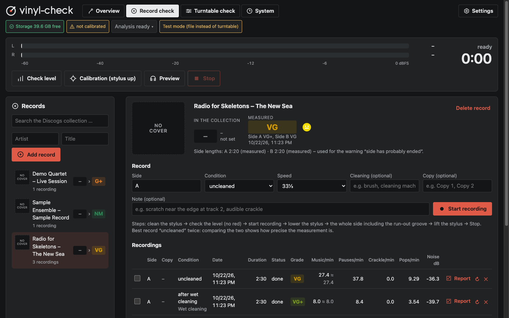
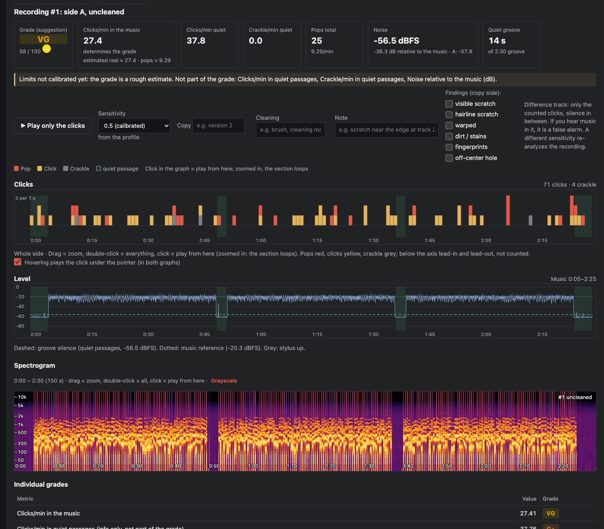
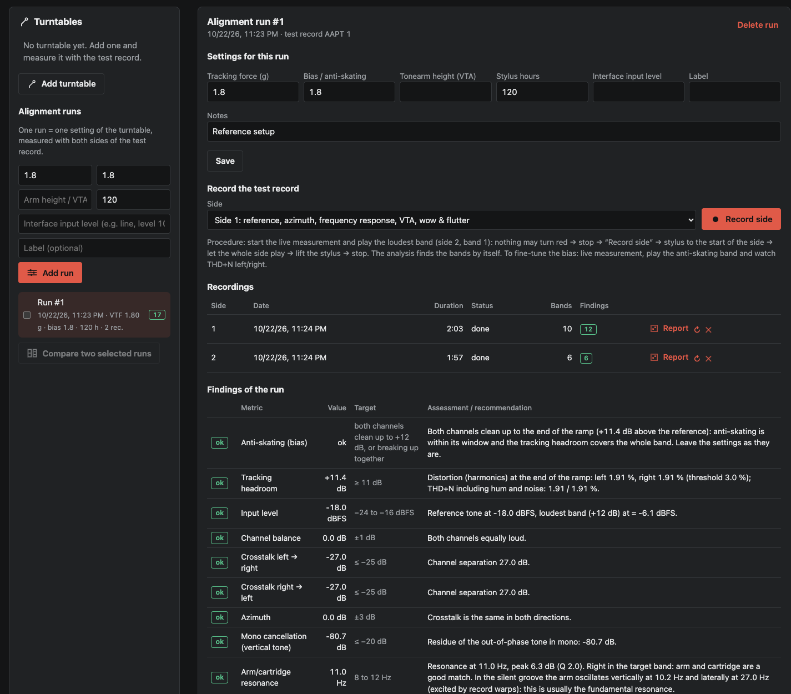

<p align="center">
  <picture>
    <source media="(prefers-color-scheme: dark)" srcset="vinylcheck/static/brand/vinyl-check-logo-inverse.svg">
    <source media="(prefers-color-scheme: light)" srcset="vinylcheck/static/brand/vinyl-check-logo.svg">
    
  </picture>
</p>

<p align="center"><b>Measure the condition of your records, and the alignment of the turntable that plays them.</b></p>

<p align="center">
  <a href="https://github.com/michaelpietzsch/vinyl-check/actions/workflows/ci.yml"></a>
  <a href="LICENSE"></a>
  
  <a href="https://github.com/michaelpietzsch/vinyl-check/releases/latest"></a>
</p>

---

vinyl-check records a side of a record through your turntable, finds clicks, pops and crackle, measures groove
noise and suggests a condition grade on the Goldmine scale. It shows what a record cleaning really achieved, checks
the alignment of your turntable with a test record, compares test pressings against the digital master and writes
PDF reports. It is a small web application written in Python. It runs on your own hardware, either on a Raspberry Pi
next to the turntable or on your computer, and works without a cloud service.

> **Your turntable is part of the measurement.** vinyl-check works with an inexpensive USB turntable as well as
> with a high-end turntable, phono stage and studio audio interface. The price of the chain matters less than its
> setup: a properly aligned budget deck gives repeatable, meaningful results, and a badly aligned expensive one does
> not. The [setup guide](docs/setup-guide.md) explains each step, and vinyl-check's alignment mode checks the result
> with a test record.

## The basic idea

At its core, vinyl-check does one simple thing: it **records a side of a record as a WAV file**, exactly as the
stylus picks it up, and **runs an analysis on that file**. Everything else is derived from this one recording:

```
record ─▶ turntable ─▶ audio interface ─▶ WAV of the side ─▶ analysis ─▶ clicks, pops, noise, grade, reports
```

- Every click and pop is found with its position and strength. Counted per minute of music, they give the
  **condition grade**.
- The same side recorded **before and after cleaning** shows what the cleaning removed and what is damage.
- A **test record** instead of music shows how well the turntable is aligned: anti-skating, azimuth, resonance,
  speed and more.
- Next to the **digital master**, the recording shows which clicks are on the vinyl and which belong to the music.

Because the WAV is kept (for a configurable number of days; the measurements are always kept), you can listen to any
spot, re-analyse with a different sensitivity and compare recordings later.

## Features

**Record condition and grading**
- Click, pop and crackle detection with a prediction-error (AR model) detector and a spectral "stripe" check that
  separates real defects from drum hits.
- Condition grade (NM, VG+, VG, G+, G, F) computed from what happens while the music plays. F is only given when
  the stylus actually skips. The grade is shown together with the criteria that produced it.
- Groove skip detection, recurring-scratch chains, groove noise, clipping and technical data (true peak, loudness
  per ITU-R BS.1770, stereo correlation, rumble, hum).
- Interactive overview, level and spectrogram charts: click any point to listen, drag to zoom, and play back only
  the detected clicks to check them by ear.

**Cleaning before and after**
- Record a side before and after cleaning. vinyl-check aligns both recordings sample-accurately and labels every
  click as *removed* (dirt), *persistent* (damage) or *new*.
- Two uncleaned recordings show how repeatable the measurement is, so only real improvements count.
- Compare several copies of the same record and follow each side's history over time.

**Turntable alignment with a test record**
- Guided turntable profiles: noise calibration, both sides of the test record, review, accept.
- Measures anti-skating and tracking reserve, channel balance, crosstalk and azimuth, arm/cartridge resonance,
  speed and wow & flutter, intermodulation (VTA), frequency response and rumble, each with a target value and advice.
- Live meter for adjustments: distortion per channel while you turn the anti-skating dial.
- Editable target presets (standard, DIN 45500, strict lab values, manufacturer data).

**Master comparison and test pressing approval**
- Optional engineer mode: upload the digital master of each side and measure a pressing against it, including
  speed of the cut, eccentricity, polarity, channel swap, frequency response, level per track, pre-echo and which
  clicks are really on the vinyl.
- Test pressing approval across several copies: stamper defects common to all copies, checkpoints and a recommendation.

**PDF reports**
- A report per recording and an approval report per record, with charts, spectrograms and excerpts, ready to send
  to a pressing plant or a client.

**Discogs collection**
- Search your Discogs collection, take over the release, tracklist and cover, and write the measured grade back as
  media condition once you confirm it.

**Learning from your judgements**
- Mark detections as *click*, *false alarm* or *unsure*. Together with master comparisons, vinyl-check learns to
  estimate how many detections are real. Each estimate is validated by cross-validation per recording.

**Multilingual interface**
- English and German: English by default, German or another language can be chosen in the settings. Most languages can be added without
  code changes ([translating guide](docs/translating.md)).

## Screenshots

| Record overview | Recording a side | Turntable alignment |
|---|---|---|
|  |  |  |

## Quick start

### Requirements

- Python 3.11 or newer; 3.13 is recommended and the reference version (tested up to 3.14).
- For recording: a USB turntable or a USB audio interface. On Linux vinyl-check records with ALSA (`arecord` from
  the `alsa-utils` package); on macOS (Core Audio) and Windows (WASAPI, ASIO) through PortAudio, which is installed
  with vinyl-check ([recording on macOS and Windows](docs/setup-guide.md#recording-on-macos-and-windows)).
- About 1–2 GB of free RAM while an LP side is analysed, and disk space for recordings (about 12 MB per minute at
  16 bit / 48 kHz, 17 MB at 24 bit / 48 kHz).

### Install from source

```bash
git clone https://github.com/michaelpietzsch/vinyl-check.git
cd vinyl-check
python3 -m venv .venv
. .venv/bin/activate              # Windows: .venv\Scripts\activate
pip install .                     # or: pip install ".[ml]" to add the second-opinion network (PyTorch)
```

On Linux, `pip install ".[portaudio]"` adds PortAudio recording as an alternative to `arecord`; macOS and Windows
get it by default.

### Run

vinyl-check reads its configuration from the TOML file named in `VINYLCHECK_CONFIG`. For a local instance, a few
lines are enough:

```toml
# config.toml
data_dir = "data"            # recordings (large)
state_dir = "state"          # database, caches (small)
host = "127.0.0.1"           # "0.0.0.0" to open the interface to other devices in your network
port = 8080
device = ""                  # empty = first USB capture device, or e.g. "hw:CARD=CODEC,DEV=0" (Linux),
                             # "Core Audio: USB Audio CODEC" (macOS), "Windows WASAPI: Line (USB Audio CODEC)"
sample_format = "S24_3LE"    # 24 bit if your interface supports it (Linux: arecord --dump-hw-params)
```

```bash
VINYLCHECK_CONFIG=config.toml vinyl-check       # same as: python -m vinylcheck
```

Then open <http://localhost:8080>. The interface walks you through the first steps: add your turntable, calibrate
the chain, align it with a test record, then check your first record ([user guide](docs/user-guide.md)).

### Try it without a turntable

The demo mode plays a WAV file instead of a turntable. vinyl-check can synthesize a test side with music, pauses,
groove noise and logged clicks:

```bash
python -c "import soundfile as sf; from vinylcheck import synth; a, _ = synth.make_side(120); sf.write('demo-side.wav', a, 48000, subtype='PCM_16')"
VINYLCHECK_FAKE_SOURCE=demo-side.wav VINYLCHECK_FAKE_SPEED=10 \
VINYLCHECK_DATA_DIR=data VINYLCHECK_STATE_DIR=state vinyl-check
```

`VINYLCHECK_FAKE_SPEED=10` plays the file ten times faster than real time. The examples use POSIX shell syntax.
In PowerShell, set each variable first, for example `$env:VINYLCHECK_FAKE_SOURCE = "demo-side.wav"`.

### Raspberry Pi as a headless station

A Raspberry Pi 5 (8 GB recommended) next to the turntable makes a quiet, always-on measuring station. Phones,
tablets and computers in the same network use it through the browser. `deploy.sh` sets it up from your computer
over SSH (key login and password-less `sudo` on the Pi):

```bash
VC_TARGET=user@raspberrypi.local ./deploy.sh
```

The script installs the Debian packages, creates the service user `vinylcheck`, copies the code to
`/opt/vinyl-check`, installs the sandboxed systemd unit (`systemd/vinyl-check.service`), runs the test suite on the
Pi and restarts the service once no recording or analysis is running. The configuration in
`/etc/vinyl-check/config.toml` is created from [`config.example.toml`](config.example.toml) on the first run and
never overwritten. `--target=user@host` passes the target as an option instead of `VC_TARGET`, `--no-test` skips
the test run on the Pi, and `--now` restarts at once even while a recording or analysis is running (it is aborted);
see the header of `deploy.sh`.

```bash
systemctl status vinyl-check
journalctl -u vinyl-check -f
```

### Desktop apps

vinyl-check also runs as a desktop app with the same interface in its own window. Download it from the
[latest release](https://github.com/michaelpietzsch/vinyl-check/releases/latest):

| System | File |
|---|---|
| macOS 11 or newer, Apple Silicon | `vinyl-check-<version>-macos-arm64.dmg` |
| Windows 10 or 11, 64-bit | `vinyl-check-<version>-windows-x64-setup.exe` (follows in a later release) |

**Install.** On macOS, open the disk image and drag vinyl-check to *Applications*. On Windows, run the installer: it
installs for your user without administrator rights (or for all users, if you choose so) and adds a Start menu
entry. The window uses Microsoft Edge WebView2, which is part of Windows 11 and current Windows 10.

**First start.** The apps are not signed yet ([code signing](docs/code-signing.md)), so the system asks once:

- macOS: open vinyl-check and close the message that macOS cannot verify it. Then open *System Settings → Privacy &
  Security* and click **Open Anyway** next to the note about vinyl-check. Before the first recording, allow access to
  the microphone: macOS uses this name for every audio input, your audio interface included.
- Windows: if Microsoft Defender SmartScreen shows *Windows protected your PC*, click **More info**, then
  **Run anyway**.

**Choose the audio interface.** Open *Settings → Audio interface*. vinyl-check picks an audio interface
automatically (never a microphone or a virtual device) and lists every device with its number of inputs and current
rate. Choose the inputs the turntable or phono stage is connected to, the sample rate and the bit depth, press
*Test* while a record plays and *Save*. On Windows, interfaces with an ASIO driver are recorded through ASIO and
others through WASAPI ([setup guide](docs/setup-guide.md#recording-on-macos-and-windows)).

**Your data.** Recordings, database and configuration stay in your user profile:
`~/Library/Application Support/vinyl-check` on macOS and `%LOCALAPPDATA%\vinyl-check` on Windows. An optional
`config.toml` there takes the same keys as on a station ([configuration](#configuration)) for advanced settings;
the log is in the `logs` folder. The apps contain everything except the PyTorch second opinion. While a recording
runs, the computer does not go to sleep.

**Use it from your phone or tablet.** In *Settings → Network access*, turn on *Allow access from other devices on
the network* (it is off by default). The settings then show the address, a QR code and an access code. Scan the QR
code with the phone's camera, or open the address in the phone's browser and enter the code once; the phone stays
signed in. Other devices always need the code, the computer itself never does, and *New code* signs all devices
out. If the firewall asks whether vinyl-check may accept incoming connections, allow it for private networks.

**Uninstall.** On macOS, quit vinyl-check and move it from *Applications* to the Bin. On Windows, open *Settings →
Apps → Installed apps*, choose vinyl-check and *Uninstall*. Your recordings and the database are kept; delete the
data folder named above to remove them as well.

**From source.** `pip install ".[desktop]"` adds the command `vinyl-check-desktop`, which opens the same window
(on Linux, pywebview needs GTK or Qt). `vinyl-check-desktop --browser` uses the default browser instead of a window.
Building the apps yourself is described in [CONTRIBUTING.md](CONTRIBUTING.md#building-the-desktop-apps).

## Recommended setups

| | Chain | What to expect |
|---|---|---|
| **Entry level** | USB turntable with built-in phono stage | Good for cleaning comparisons and rough grades. Fixed gain and a higher noise floor; the turntable profile records the chain's own reference level and click floor so results stay comparable. |
| **Recommended** | Turntable, phono preamp, audio interface at 24 bit / 48 kHz | Adjustable levels and lower noise. This is the reference setup for grading. |
| **High end** | Well-aligned turntable, low-noise phono stage, studio interface | Lowest noise floor, reliable alignment measurements, test pressing approval against the master. |

Every setup needs the same basics: correct tracking force, anti-skating, VTA, azimuth and overhang, a level
calibration and a clean stylus. The [setup guide](docs/setup-guide.md) covers each step and has a checklist for
every session. For detecting clicks and pops, 16 bit / 44.1 kHz is always enough; the setup matters more than the
converter. Concrete turntables for both entry routes, USB and built-in phono preamp into an audio interface, are
listed under [example setups](docs/setup-guide.md#example-setups).

## How it works

1. **Capture**: the side is recorded bit-exact from the audio device (no resampling) with live level, clipping and
   dropout monitoring. The recording stops by itself when the stylus reaches the run-out groove.
2. **Detection**: an autoregressive model predicts every sample. Clicks show up as peaks in the prediction error.
   A high-frequency stripe test, a second-opinion network and your own judgements remove false alarms.
3. **Segmentation**: lead-in, music, pauses and run-out groove are found from the level curve. The track borders
   come from the Discogs tracklist.
4. **Grading**: clicks and pops per minute of music, weighted 90 / 10, mapped to the Goldmine scale. A skip
   means F. The record grade is the average of its sides.
5. **Comparison**: recordings are aligned by cross-correlation, including speed differences, and events are
   matched within ±4 ms.
6. **Alignment**: the bands of the test record are recognised by their signal, then measured with
   Blackman-Harris spectra, THD and THD+N, sweeps and a resonance model.

Details, thresholds and validation results: [docs/measurement.md](docs/measurement.md).

## Configuration

All settings have defaults. [`config.example.toml`](config.example.toml) lists the keys with comments. A service
reads the file named in `VINYLCHECK_CONFIG` or `/etc/vinyl-check/config.toml`. Without either, vinyl-check uses the
folders of the user who runs it: `config.toml` and the data in `~/Library/Application Support/vinyl-check` on macOS
and `%LOCALAPPDATA%\vinyl-check` on Windows, `~/.config/vinyl-check/config.toml` and `~/.local/share/vinyl-check` on
Linux (XDG). The most important keys:

| Key | Default | Meaning |
|---|---|---|
| `data_dir`, `state_dir` | `/mnt/data/vinyl-check`, `/var/lib/vinyl-check` | recordings and database (service; see above for the user folders) |
| `language` | `"en"` | interface language until a user picks one in the settings; `"auto"` follows the browser |
| `access_code` | `""` | other devices in the network must enter this code once; empty = open to the local network (the [setup guide](docs/setup-guide.md#running-as-a-service-in-a-network) recommends a code) |
| `trusted_hosts` | `[]` | names a reverse proxy serves the interface under, e.g. `["vinyl.example.net"]`; IP addresses, `localhost`, `.local` names and the host name are always accepted |
| `device` | `""` | capture device (ALSA `hw:` name, or PortAudio `<audio system>: <name>`), empty = chosen automatically |
| `rate`, `channels`, `sample_format` | `48000`, `2`, `"S16_LE"` | capture format (`S16_LE`, `S24_3LE`, `S32_LE`) |
| `capture_channels`, `input_channels` | — | for interfaces that only record with all their channels open |
| `audio_backend` | `"auto"` | `"alsa"` (arecord), `"portaudio"` (Core Audio, WASAPI, ASIO); auto = arecord on Linux if installed |
| `wasapi_exclusive`, `asio` | `true`, `"auto"` | Windows: WASAPI exclusive mode; ASIO drivers where installed, `false` = WASAPI only ([setup guide](docs/setup-guide.md#windows-wasapi-and-asio)) |
| `require_mount` | `""` | refuse to record unless this mount point is present (protects an SD card) |
| `retention_days` | `30` | delete original audio after this many days; measurements are kept |
| `discogs_token`, `discogs_username` | — | Discogs access via personal token; a token entered under *Settings → Discogs* takes precedence |
| `discogs_consumer_key`, `discogs_consumer_secret` | — | Discogs access via OAuth app ("Connect with Discogs" in the settings) |
| `vinyl_mind_url` | `"https://api.vinylcheck.net"` | Vinyl-Mind server that *Settings → Vinyl-Mind* offers and *Reset to default* restores ([Vinyl-Mind on the station](docs/vinyl-mind.md)) |
| `vinyl_mind_invite_url` | `""` | for a server without accounts: where its operator hands out invitation codes; *Where do I get a code?* links there |
| `feature_version` | `"1"` | features of the learning model; `"2"` (experimental) takes the turntable profile as the zero point ([measurement](docs/measurement.md#learning)) |

Device, sample rate, bit depth, the input pair and the Windows options can also be set in the interface under
*Settings → Audio interface*: values saved there take precedence over the file, apply from the next recording without
a restart, and *Back to the configuration file* removes them. The same holds for the Discogs access token under
*Settings → Discogs*, so the desktop apps need no configuration file at all. Further sections of
`config.example.toml` hold the detector, analysis, grading and alignment parameters. Many values can also be changed
in the interface under *Settings*. Environment variables override the file: `VINYLCHECK_DATA_DIR`,
`VINYLCHECK_STATE_DIR`, `VINYLCHECK_PORT`, `VINYLCHECK_FAKE_SOURCE`, `VINYLCHECK_FAKE_SPEED`,
`VINYLCHECK_REQUIRE_MOUNT`, `VINYLCHECK_RETENTION_DAYS`, `VINYLCHECK_DISCOGS_TOKEN`, `VINYLCHECK_DISCOGS_USERNAME`,
`VINYLCHECK_DISCOGS_CONSUMER_KEY`, `VINYLCHECK_DISCOGS_CONSUMER_SECRET`, `VINYLCHECK_DISCOGS_SYNC_MINUTES`,
`VINYLCHECK_AUDIO_BACKEND`, `VINYLCHECK_FONT_DIR` (IBM Plex fonts for the PDF reports).

The REST API is documented at `/docs` on a running instance.

## Languages

The interface, API messages and PDF reports are available in **English** and **German**. vinyl-check starts in
English (or in the language set with `language` in the configuration; `"auto"` follows the browser), and each
user can change it in the settings. Numbers and dates use
the conventions of the chosen language. To add a language, see [docs/translating.md](docs/translating.md).

## Documentation

| Document | Content |
|---|---|
| [Setup guide](docs/setup-guide.md) | turntable chains from USB to high end, alignment basics, level calibration, session checklist |
| [User guide](docs/user-guide.md) | the workflow in the interface |
| [Measurement](docs/measurement.md) | how detection, grading, comparison and alignment work |
| [Architecture](docs/architecture.md) | design of stations learning together through Vinyl-Mind (roadmap) |
| [Vinyl-Mind on the station](docs/vinyl-mind.md) | what the station does with the hub's specification (protocol version 1): connecting, what leaves a station, global models |
| [Design system](docs/design-system.md) | interface principles, tokens, components ([preview](docs/design-preview.html)) |
| [Translating](docs/translating.md) | adding a language |
| [Code signing](docs/code-signing.md) | signing status of the desktop apps, first start on macOS and Windows |
| [Changelog](CHANGELOG.md) | release history |

## Roadmap

- **Linux desktop app** (AppImage) next to the macOS and Windows apps, and signed apps on both systems.
- **Vinyl-Mind**: stations learn together. Each turntable profile trains its model locally, with the measured
  profile as the zero point so that setups become comparable; only model weights and counts are shared,
  never audio. A separate hub project combines them (federated averaging) and hands back a global model
  that each station checks on its own data before using it ([architecture](docs/architecture.md)). The station
  side is in place (*Settings → Vinyl-Mind*, [Vinyl-Mind on the station](docs/vinyl-mind.md)), the hub is in alpha,
  and signing in with an account on the project's website is next.
- **More test records**: band layouts beyond the Analogue Productions AAPT 1, 45 rpm alignment tones.
- **Grade calibration** against a larger set of records with known condition.
- **WAV import** of recordings made elsewhere.

## Contributing

Contributions are welcome: bug reports, measurements from your setup, translations and code. Please read
[CONTRIBUTING.md](CONTRIBUTING.md) first.

## License

vinyl-check is free for personal and other non-commercial use under the
[PolyForm Noncommercial License 1.0.0](LICENSE): at home, for hobby and research, in schools and charitable
organisations. You may change it and share it for these purposes, as long as the license and the copyright notice
travel with it.

### Commercial use

Using vinyl-check commercially is not covered by this license. That includes using it in a business (for example a
mastering studio, a pressing plant, a record shop or a grading service), offering it as a service, and selling it or
anything built from it. A commercial license is available from the author; please write to
[pietzsch@michaelpietzsch.de](mailto:pietzsch@michaelpietzsch.de).

The name vinyl-check and its logo are not licensed for other products.

The click-detector weights in `vinylcheck/weights/` come from GrooveClean and are licensed under the MIT License
([license](vinylcheck/weights/LICENSE-grooveclean.txt)).

## Acknowledgements

- [GrooveClean](https://github.com/Booyaka101/grooveclean) by Chris Bosch (MIT) for the click-detector network used
  as a second opinion, and for ideas such as the single sensitivity control and the clipped-peak check.
- The grading scale follows the Goldmine standard as used by Discogs.
- This application uses Discogs' API but is not affiliated with, sponsored or endorsed by Discogs. "Discogs" is a
  trademark of Zink Media, LLC.
- vinyl-check is not affiliated with Analogue Productions. The AAPT 1 test record is referenced for its documented
  band layout.
- ASIO is a trademark and software of Steinberg Media Technologies GmbH. The Windows app records from ASIO drivers
  through PortAudio's ASIO build, used under the Steinberg ASIO SDK Licensing Agreement.
